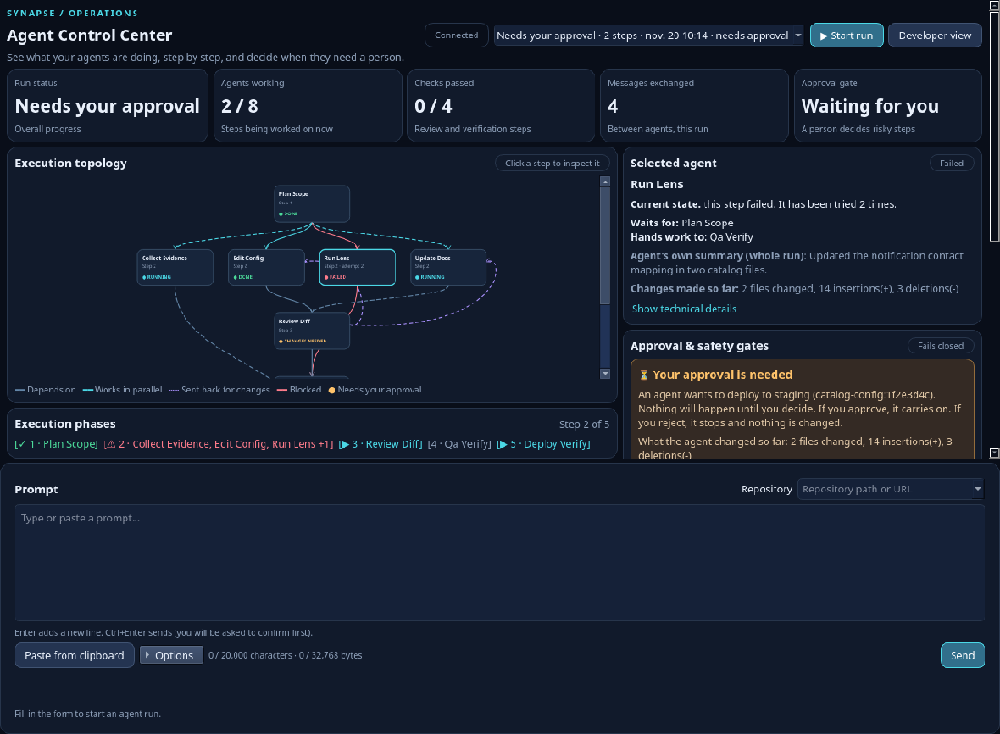

# Desktop operator console

The PySide6 desktop (`python -m synapse.desktop`) talks to the daemon over the private local socket. It never displays or logs tokens; approver tokens are only entered in the per-decision dialog.

## Control Center (default view)

The desktop opens on the **Control Center**, a plain-language, dark-themed overview of the selected run. The earlier tabbed technical console is unchanged and lives under the **Developer** view (the "Developer view" button, or the view tabs).

- Header with connection pill, a run switcher (the newest 100 runs from `GET /api/v1/runs?limit=100`, refreshed every third poll; when a full page comes back, a disabled last entry says older runs exist: list them with `agentctl runs --cursor` and paste the ID in the Runs view) and a prominent **Start run** button that opens the existing start forms.
- Five tiles from real data: run status, agents working n/N, checks (or steps) done n/N, messages exchanged, approval gate. "Checks passed" is only shown when some steps are identifiable as review or verification steps; otherwise the tile says "Steps done".
- **Execution topology**: one card per run task, layered by dependency, with status badge (IDLE, RUNNING, DONE, FAILED, WAITING), solid edges for dependencies and parallel fan-out, and purple dashed feedback edges only from a step in `changes_required` back to its prerequisites. Flow animation runs only while a step is running and the view is visible, and is off under reduced motion (`SYNAPSE_REDUCED_MOTION=1` or the `ui/reduced_motion` setting). Click a card to inspect it. With no runs it shows "No runs yet — start one".
- Phase strip, agent roster with progress bars, and a detail pane for the selected step (uses `GET /api/v1/runs/{id}/agent` when available).
- **Approval & safety gates** explains locked, pending, approved, rejected and expired states in plain words; Approve and Reject open the existing token decision dialog (token handling is unchanged).
- Agent communication feed: events and messages rendered as sentences by `desktop/narrative.py`, with a safe generic fallback for anything unknown.
- **Prompt composer**, always at the bottom: plain-text multi-line editor (Enter = new line, Ctrl+Enter sends after the usual confirmation), paste is stripped to plain text, "Paste from clipboard" button, live character and UTF-8 byte counters against the 32768-byte daemon limit (Send is disabled when over), a guard that keeps only the first 100 KiB of a huge paste, text-file drop (UTF-8 only, 256 KiB cap, binary refused), repository selector and an Options section (tools, permission mode, approval gate) with safe defaults. Validation, payload and Idempotency-Key reuse are shared with the Start run form. Prompt text is never stored, logged or shown in status messages. After an accepted send the new run is selected.

Screenshots are rendered from fixture data (never shown by the real view) with `QT_QPA_PLATFORM=offscreen PYTHONPATH=src python scripts/render_control_center.py`.

## Connection and replay

- The header shows `Connected` or `Disconnected — reconnecting (attempt N, retry in Ns)`, with a detail line explaining what is stale.
- Reconnect uses exponential backoff starting at the poll interval (1 s), doubling up to 15 s, and resets on the first successful poll. Panes keep their last result while disconnected.
- Event replay uses a single cursor (last delivered sequence), persisted across restarts (`desktop-cursor.md`). It only advances after an event is delivered to the UI, so a drop or daemon restart resumes with `after=<cursor>`: no event is skipped or shown twice. A malformed event aborts the page and the page is re-requested from the cursor.
- Catching up on a backlog fetches the next 100-event page immediately rather than waiting a full interval.

## Runs

- Enter a run ID (or pick from "Runs inspected this session") to see run state, a per-task list (node, state, attempts), and the dependency graph. The graph is only rebuilt when tasks or dependencies change.
- Tasks in `awaiting_approval` are summarised, and the requested approvals for the run found on the currently loaded approvals page are listed with approval id, operation and target. "Review selected approval…" switches to the Approvals tab and selects it; the existing Approve/Reject dialog performs the decision.
- Cancel: the daemon only exposes `POST /api/v1/runs/{id}/mock-cancel`, which the existing "Cancel fixed mock run" button uses.

## Layout of the code

`src/synapse/desktop/`: `__main__.py` (entry point, stable import path), `connection.py` (Poller: the only thread talking to the daemon), `main_window.py` (tabs, menus, shortcuts, status bar), `approvals_view.py`, `runs_view.py`, `messages_view.py`, `events_view.py` (tab logic, mixed into `MainWindow`), `start_panel.py`, `agent_form.py`, `agent_view.py`, `agent_usage.py`, `notifications.py`, `redaction.py`, `status_bar.py`, `shortcuts.py`, plus the existing `approval_decision.py` and `mock_resume.py`. No API, CLI or daemon code is involved.

## Approvals first

- The console opens on the Approvals tab. The tab title carries a badge, `Approvals (N)`, and the status bar shows `Pending approvals: N` (`N+` when more pages exist). The count is the requested approvals on the loaded page.
- The newest requested approval (highest id) is auto-selected when nothing is selected or the selection is no longer requested, and whenever a new request arrives. Selection is never moved while the decision dialog is open or a decision is in flight.
- A newly requested approval (first page only; the initial backlog is not announced) raises a notification: a system tray message when a tray is available, otherwise a 10 s status-bar message. The text is only `<operation> on <target>` (or a count plus the latest), truncated, with no ids, digests, reasons or payload.
- Approve/Reject use the existing decision dialog (per-decision token entry; the token is never stored, displayed or logged).

## Events timeline

- Filters: run (runs seen in events, plus an "Inspected run" shortcut button), event type (types seen so far), and text search. Search covers the safe top-level fields only (sequence, type, aggregate type/id, run id, timestamps, correlation/causation ids), never the payload.
- Selecting an event shows its JSON in a detail pane. Any key whose name matches token, secret, credential, password/passwd, api key, authorization or private key (any depth, case-insensitive) is shown as `[REDACTED]`; output is size-bounded. Filters change the view only: the 1000-event buffer and cursor are unaffected, and the status line reports how many rows are hidden.

## Status bar

Permanent fields: daemon socket path, health, API version (`v1`, plus the daemon version if health ever reports one), connection state (`connected` or `reconnecting (attempt N, retry in Ns)`), and pending approvals.

## Keyboard shortcuts (Help > Shortcuts, F1)

Ctrl+1 / Ctrl+2 Control Center / Developer; Alt+1..4 Developer tabs (Events, Runs, Messages, Approvals); Ctrl+Shift+A jump to the active approval gate (focuses Approve; with no gate it opens the Approvals list); Ctrl+N Configure run; Ctrl+F search Events (Developer) or focus the Activity filter (Control Center); Ctrl+Enter send the prompt; Ctrl+0 reset topology zoom; F5 refresh (polls immediately, cuts a reconnect backoff short); F1 shortcuts; Ctrl+Q quit. Approve selected / Reject selected stay in the Approvals menu without a key. The same table drives the actions and the dialog.

## Offline behaviour

The poller retries after 2, 4, 8, then every 15 s. From the first failed poll the status bar says "Daemon offline", a slim bar at the top shows "Retry now", and Send, Approve, Reject, Stop and the Developer commit/abandon/remove/cancel buttons are disabled with a tooltip that says why; they come back on reconnect. Approval notifications never time out: the tray message and the status-bar message stay until no approval is pending.

## Start run panel

`StartRunPanel` (Runs tab) has two modes, chosen with a combo box:

- **Mock fixture (queued run)**: unchanged; emits a `StartRequest(run_id, kind)` and drives `POST /api/v1/runs/{id}/mock-start` through the poller.
- **Agent run**: the `AgentRunForm` in `agent_form.py`, which starts a real agent run with `POST /api/v1/agent-runs`.

### Start agent run form

Fields: Claude account (a picker fed by `GET /api/v1/profiles`, refreshed every few polls; see below), repository (editable combo; the last 8 repositories are remembered in non-secret `QSettings` under `agent/recent_repos`, never prompts, tokens or credentials), base ref (default `main`), multi-line prompt, allowed tools (checklist; Read/Glob/Grep on by default, Edit/Write/NotebookEdit/Bash off), permission mode (`plan` default, `acceptEdits`, `dontAsk`, `manual`; bypass and auto modes are not offered), timeout (1 to 3600 s, default 900), and an optional "Require my approval before the agent starts" step with operation/target prefilled (target `<sanitised repo basename>:<first 16 hex of the prompt SHA-256>`, at most 128 characters; editable) plus a lifetime of 1 to 86400 s.

Client-side validation mirrors the daemon contract (required fields, single-line repo without embedded `user:pass@` credentials, safe ref syntax, prompt at most 20000 characters and at most 32768 UTF-8 bytes without NUL, base ref starting with a letter or digit and not ending in `/`, `.` or `.lock`, at least one tool, known mode, integer timeout 1-3600 s, approval operation/target 1-128 characters of `A-Za-z0-9._:/@+-` only, so no spaces). Problems are listed and nothing is sent. A valid form opens a confirmation summary (repository, ref, mode, tools, timeout, prompt length and hash, a warning when edit/Bash tools are allowed, and the approval step) before anything is sent.

Request: `Authorization: Bearer <operator token>` (added by the transport; the form never sees it), `Idempotency-Key`, `X-Correlation-ID`; body `{repo, base_ref, prompt, allowed_tools, permission_mode, timeout_seconds, approval_step|null}`. A fresh key is generated per submission and reused only when the byte-identical payload is retried after a lost or failed response; editing any field starts a new submission. On acceptance the new run is selected on the Runs tab. 404 and 503 show "Agent runs are not available or not configured on this daemon."; 409 shows that a run is already active; 422 says a value exceeds the daemon's limit (for example the timeout) or a tool is not allowed by the daemon's operator config (the transport keeps no response body, so the two cannot be told apart); other failures show a generic retry message. Exception text and response bodies are never displayed.

#### Claude account picker

The first entry is "Choose a Claude account..." and is never replaced by a default: the operator must pick an account for every run, and the Start/Send button stays disabled (and a submit shows "Choose a Claude account for this run.") until one is chosen. Disabled profiles and profiles in a cooldown are listed with the reason in their label ("disabled", "cooling down, about N min left") but cannot be selected; a chosen profile that becomes unusable on refresh drops back to "Choose", it is never swapped for another (no fallback, no rotation). The chosen id is sent as `"profile"` in the POST body and shown in the confirmation summary. The picker has three states. Before the first answer it shows "Loading accounts..." and Start is disabled; the Poller fetches the accounts right after connecting and retries every loop until it gets an answer, and any failure other than 404/503 (or a lost connection) puts the picker back to loading with a visible reason. Only an explicit 404/503 (or an empty list) makes it "Not available on this daemon (the daemon's default account will be used)": then no `profile` is sent, and if the operator had chosen an account that the daemon stops listing (for example a restart answering 503) the choice is cleared with a visible notice. The confirm summary always names the account ("what you chose") or says "Claude account: daemon default" when none is sent. Cooling-down accounts are not selectable here, but a daemon only refuses unknown/disabled profiles at start (422); a cooldown makes the task fail closed before spawning. A daemon 422 is shown with the daemon's own reason (a short plain-text `detail`, sanitized) instead of the generic text; other 422s without a reason keep the generic message. The Control Center composer carries the same picker. The Agent pane shows "Claude account: ID" (or "Claude accounts: a, b" when tasks differ) for the selected run, read from each task's `profile_id` (else `spec.profile`) in `GET /api/v1/runs/{id}/agent`, and from a top-level `profile` if a daemon returns one; nothing is shown when none is present.

### Agent detail pane

On the Runs tab the poller also reads `GET /api/v1/runs/{id}/agent` for the selected run (re-probed only every 10th poll after an unavailable answer) and the Agent pane shows outcome, bounded summary text, tool names (first 50), worktree status/head/diff stat and a read-only monospace diff viewer. Everything is treated as untrusted plain text: control characters are stripped, the summary is cut at 8000 characters and the diff at 60000, and the pane states when the diff is truncated (by the daemon or locally). When the run has a requested approval, a banner offers Approve... / Reject... which select that approval and open the existing token decision dialog. "Cancel agent run..." asks for confirmation and then calls `POST /api/v1/runs/{id}/agent-cancel` (empty body, as the daemon refuses any body; one idempotency key per run, reused on retry); it is disabled once the outcome is known or the run is terminal.

#### Abandon, worktree removal and usage

All three reuse routes already on main; the Poller is still the only thread that talks to the daemon, and no token handling changed. Outcomes are shown as plain sentences; response bodies and exception text are never displayed.

- **Abandon recovering run...** calls `POST /api/v1/runs/{id}/agent-abandon` with `{"expected_run_version": N, "assertion": "no-agent-process-remains"}` (N is the state version of the loaded run snapshot). It is enabled only while the run state is `recovering`, an agent detail is loaded and no other request is in flight. The confirmation says that the run is failed and its unfinished tasks cancelled, that recovery stops and nothing is resumed, that a still-requested parked approval is revoked, that the worktree is kept, and that confirming asserts you have checked no agent process for the run is still running (the daemon cannot verify this). 409 (no longer recovering or version changed), 422 and 404/503 each show their own message; a lost response keeps the idempotency key (one per run and version) so a retry replays; a refused request starts a fresh key next time.
- **Remove worktree...** calls `POST /api/v1/runs/{id}/agent-worktree-remove` (empty body). Enabled only when the run state is `succeeded`, `failed` or `cancelled`. The confirmation lists what is removed (each task's worktree directory and branch) and what is not (the run, events, artifacts). A 409 may mean the run is not finished or a worktree has uncommitted changes; because the daemon can remove task 1 and then fail on task 2, the message says removal was refused or incomplete, that some task worktrees may already be gone, and to check the run's audit trail and refresh (it never claims nothing was removed). **Forced removal (`?force=true`) is CLI/API-only**: it discards uncommitted work and unmerged commits irreversibly, so the desktop deliberately does not offer it. A response that is not the documented success shape (`run_id`, `removed`, `tasks`; for abandon `state == "failed"`) is reported as an unexpected response. If another command is in flight, or the run changed while the confirmation was open, the desktop says so and sends nothing.
- **Commit changes...** calls `POST /api/v1/runs/{id}/agent-worktree-commit` with `{"message": "<text>"}`. Enabled only when the run state is `succeeded`, `failed` or `cancelled` AND the worktree view says `dirty`, and no other command is in flight. It opens a small dialog asking for the commit message (required, at most 2000 characters, multi-line allowed); cancelling sends nothing. The request goes off the UI thread like the other actions, with a Bearer operator token, `Idempotency-Key` and `X-Correlation-ID` (the key is derived from the run and a digest of the message, so a lost-response retry of the same text is replayed; a refused attempt gets a fresh key). On success the pane shows each task's branch and the first 12 characters of the new head, and says your own checkout was not touched and nothing was pushed. 409 (nothing to commit, run not finished, or refused), 422 (invalid message), 404/503 and any other failure show a short fixed sentence; raw server text and the message you typed are never shown. The message is held only in the pending request: it is not logged, not stored in settings and not kept after sending. A response that is not the documented shape (`run_id`, non-empty `tasks` with `task_id`, `branch`, `head`, `paths`) is reported as an unexpected response. Verified with offscreen tests and a fake daemon client only.
- **Usage** (`usage_pane`, `agent_usage.py`) shows `GET /api/v1/runs/{id}/usage?limit=200` with the agent detail: one row per observation of the first page (at most 200; when the daemon reports another page the status line says "more exist (totals cover all rows)", because totals and coverage are always whole-run) (task, attempt, input, output, cache read, cache write, cost). It is provider-reported, and cost is labelled an estimate. A field the provider did not report is shown as `unknown`, never `0`; a real zero is shown as `0`. The totals line sums known values only and says "lower bound" with `known/attempts` whenever coverage for that field is partial. Empty ledger, 404/503 and unreadable responses have their own text; values must be non-negative integers (cost a finite number) or the response is rejected, and a cost too large for a float is treated as unknown. Coverage with known > attempts is shown as `unknown (inconsistent coverage)`. The table has an accessible name and description, truncated ids carry the full id as a tooltip, labels render as plain text, and the pane is cleared when the agent detail becomes unavailable for the run.

Verified with offscreen tests and a fake daemon client only; not click-tested against a real daemon.

The approval decision dialog shows the same bounded diff as a read-only block when the approval belongs to the selected agent run. It is display only: token entry, validation, the request body and the poller path are unchanged.

### Repositories pane (multi-repository runs, ADR 026, read only)

Below the Agent pane, the Runs tab shows a "Repositories" pane only when the selected run has more than one repository, has a candidate manifest, or one of the multi-repository responses was not understood (the pane then says which). Otherwise it stays hidden and nothing changes for single-repository runs. It is read only: no build, approve or deploy action lives here.

- One row per repository in the run: id, access (`write` or `read`; `write (run says read)` when the run's bindings and the manifest disagree), baseline ref and pinned SHA, candidate SHA and state. States: `changed`, `unchanged (candidate = baseline)`, `read only (pinned baseline)`, or the current commit-phase state, chosen by `(attempt_no, seq)` (`commit in progress`, `commit failed: <reason>`, `not committed`, `unknown after a crash (needs recovery)`).
- Deploy column, taken only from the run's own binding rows (the run's snapshot of the registry, ADR 026 D1), never from the live registry: "generated by the pipeline, not deployed by Synapse" for a changed repository whose binding carries `"deploy": "none"`; "not deployed (unchanged)" for an unchanged one; "target not known here" for a changed repository without the marker (this view does not know the deploy targets); "unknown" when the run's bindings are unavailable or the marker has an unexpected value; `-` for read-only and not-yet-committed repositories.
- The newest candidate manifest (highest `seq`) is summarised as:
  - INVALIDATED when either the list row or the detail carries a non-empty invalidation list; every element counts, and an unrecognised or malformed reason is shown as "unrecognised reason";
  - validity unknown when neither response carries an invalidation list, or after 3 consecutive failed refreshes;
  - not usable when this view found a problem: the daemon answered with a different manifest than requested, the run's repository set or a repository's access differs from the manifest's, `bindings_sha256` differs, repositories are unsorted or duplicated, a v2 write repository's validations are not exactly `paths_editable` and `xml_well_formed` both passed, a different run, or no changed write repository;
  - valid only when none of the above applies. "Valid" never means the desktop recomputed `manifest_sha256`.
  Anything other than valid gets a bold banner saying not to act on it.
- Selecting a row shows that repository's diff in a read-only monospace box (also for a repository the run calls read only when the manifest says write). Diffs are untrusted agent output: plain text, at most 4000 lines and 60000 characters. Control, format (bidi, zero-width, tag, variation selector, soft hyphen), separator, private-use and surrogate characters are replaced with a visible U+FFFD and counted in the note; the note also says whether the diff is truncated and whether the daemon's diff text (before replacement) has the manifest's `diff_sha256`.
- Every label is forced to plain text and table cells are not editable, so markup is shown literally. Single-line fields (reasons, branches, ids) additionally have every whitespace run, including newlines and U+2028/2029, collapsed to one space, so a reason cannot fake extra lines. Repository bindings whose id does not match the safe-id pattern are dropped and counted in the status line; other malformed ids, refs and SHAs are shown as `-`.
- If a refresh fails with anything other than 404/405/501, the last view stays with "Could not refresh since HH:MM (N failed attempts)"; after 3 failures a "valid" manifest is downgraded to "validity unknown".

The routes are ADR 026 proposals and the daemon does not serve them yet: `GET /api/v1/runs/{id}/repos`, `GET /api/v1/runs/{id}/candidate-manifests` and `GET /api/v1/runs/{id}/candidate-manifests/{sha}` (the registry view `GET /api/v1/repos` is listed but not read by the desktop). All paths live in `src/synapse/desktop/multirepo_routes.py` only. When both the run-repositories and the manifest-list routes answer 404, 405 or 501, the pane stays hidden and that run is re-probed only every 30 polls. The response envelopes the desktop expects (field names inside them are the ADR's table columns) are listed in the docstring of `src/synapse/desktop/multirepo_model.py`; until A publishes the route table they are assumptions.

There is no `agentctl` command for these reads yet: the ADR names `repos list` and `manifest show/diff`, but the routes are proposals with no response schema, so a CLI would bake in guesses.

Verified with offscreen tests against ADR-shaped fixtures only; not tested against a daemon that serves these routes (none exists yet).

## Limits

- Events view keeps the latest 1000 rows and shows how many were received/dropped from view. Threads, messages and approvals are paged at 100 with previous/next. The task list shows at most 200 tasks (the graph at most 1000).

## Known gaps (API, not changed here)

- No run-list endpoint: the "run list" is the runs inspected in this session.
- No generic run cancel endpoint, only the mock fixture cancel.
- Tasks carry no approval id, so a parked task cannot be linked to its approval exactly; the UI lists the run's requested approvals beside the parked tasks. Approvals beyond the first loaded page need "Next approvals".
- If a daemon restart resets event sequences below the cursor, the page is rejected and the console stays in reconnecting state; restart the desktop.
